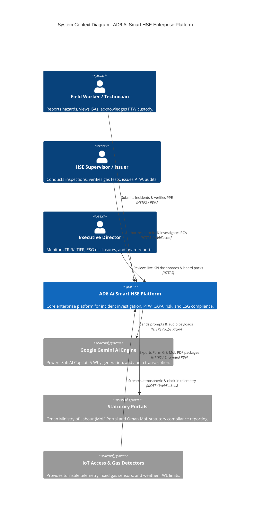
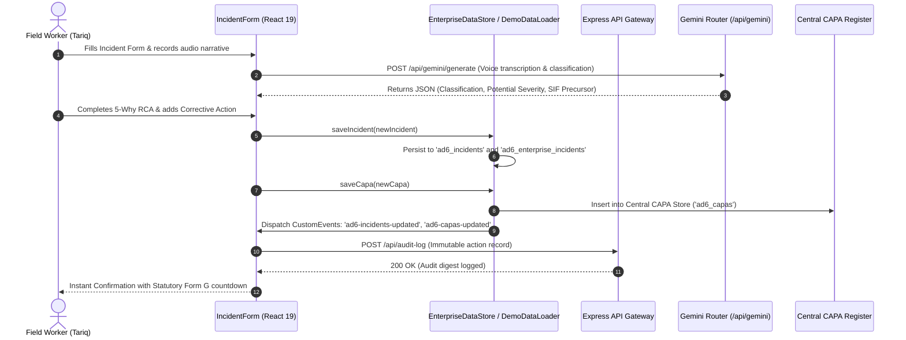

# Architecture Specification — AD6.Ai Smart HSE Enterprise Platform

**Document Version:** 2.0.0-PROD  
**Architect:** Principal Software Architect & DevOps Lead  
**Runtime Environment:** Hybrid Single-Page Application (React 19) + Express 5 Gateway / Full-Stack Node Runtime  
**Deployment Target:** Google Cloud Run (Containerized Docker) / Enterprise Kubernetes  

---

## 1. System Overview & Architecture Assessment

### 1.1 Current Architecture Reality (Prototype State)
The current AD6.Ai application operates as a **full-stack hybrid**:
1. **Frontend:** React 19 SPA running with TypeScript 5.8 and Vite 6.4, utilizing Tailwind CSS for styling, Recharts for analytics, and Lucide React for iconography.
2. **Backend Gateway:** Node.js Express 5.2 server (`server.ts`) acting as an API gateway, WebSocket hub (`Socket.IO 4.8`), and security proxy to Google Gemini AI models.
3. **Data Layer:** Currently operating with a high-fidelity browser `localStorage` layer unified under `services/demoDataLoader.ts` and `services/enterpriseDataStore.ts` with dual-syncing canonical (`ad6_*`) and legacy (`ad6_enterprise_*`) keys, supplemented by client-side IndexedDB for offline field caching (`idb 8.0`).
4. **AI Gateway:** Server-side router (`routes/geminiRouter.ts`) utilizing `@google/genai` (v1.42.0) with an isolated `GEMINI_API_KEY` environment variable and a 30-second proxy execution timeout.

### 1.2 Target Enterprise Architecture (Production State)
To graduate this prototype into a multi-tenant enterprise solution, the target architecture transitions persistence to a durable relational database (**PostgreSQL 16** with Row-Level Security), introduces an enterprise identity provider (OIDC/SAML 2.0), and encapsulates AI capabilities within a Model Context Protocol (**MCP**) server.

---

## 2. System Context Diagram (C4 Level 1)



---

## 3. Container & Service Architecture (C4 Level 2)

```mermaid
graph TD
    subgraph Client Tier [Client Tier - Browser & PWA]
        SPA[React 19 Single Page App]
        PWA_Cache[Service Worker & IndexedDB]
        Local_Store[Unified Reactive Enterprise Store]
    end

    subgraph Gateway Tier [Gateway Tier - Node.js Express 5]
        Proxy[Express HTTP & WebSocket Server]
        Auth_MW[RBAC Authorization Middleware]
        Rate_Limit[Rate Limiting & Security Headers]
        Gemini_Router[routes/geminiRouter.ts]
        Audit_Router[Audit Logging Middleware]
    end

    subgraph AI Tier [AI & Grounding Tier]
        Gemini_SDK[@google/genai v1.42.0]
        Search_Ground[Google Search Grounding]
        Maps_Ground[Google Maps Grounding]
        Voice_STT[Gemini Audio Transcription]
    end

    subgraph Data Tier [Production Data Tier - Target State]
        Postgres[(PostgreSQL 16 Database with RLS)]
        Prisma[Prisma ORM / Connection Pool]
        BlobStore[Encrypted Object Storage: Evidence Photos]
    end

    SPA -->|REST API & WS Events| Proxy
    SPA <--> PWA_Cache
    SPA <--> Local_Store

    Proxy --> Rate_Limit
    Rate_Limit --> Auth_MW
    Auth_MW --> Gemini_Router
    Auth_MW --> Audit_Router

    Gemini_Router --> Gemini_SDK
    Gemini_SDK --> Search_Ground
    Gemini_SDK --> Maps_Ground
    Gemini_SDK --> Voice_STT

    Auth_MW --> Prisma
    Prisma --> Postgres
    Proxy --> BlobStore
```

---

## 4. Component Interaction & Request Lifecycle

### 4.1 Incident Reporting & Central CAPA Synchronization Flow



---

## 5. Security & Authorization Boundaries

### 5.1 Defense-in-Depth Model
1. **Network Layer:** Strict HTTPS, HSTS, secure cookie policies, and CORS restricted to explicit tenant domains.
2. **Gateway Layer:** In `server.ts`, all incoming payloads undergo size limiting ($50\text{MB}$ maximum for batch image evidence), MIME validation, and non-blocking audit logging.
3. **Application Layer (RBAC):** `services/permissionService.ts` defines explicit role matrices (`ADMIN`, `HSE_DIRECTOR`, `AREA_AUTHORITY`, `SITE_SUPERVISOR`, `PERMIT_RECEIVER`, `AUDITOR`).
4. **Segregation of Duties (SoD):** Client and server enforce dual-custody verification:
   - Action owners cannot self-verify CAPAs.
   - Permit receivers cannot self-issue or self-authorize permits.
5. **AI Secret Isolation:** `GEMINI_API_KEY` is strictly maintained in server-side environment memory and is never bundled into client Vite distributions.

---

## 6. Deployment Topology & Operational Readiness

### 6.1 Container Specification (Google Cloud Run / Kubernetes)
- Base Image: `node:22-alpine`
- Build Process: Multi-stage Dockerfile. Stage 1 compiles Vite frontend and bundles `server.ts` into `dist/server.cjs` via `esbuild`. Stage 2 packages production node modules and starts via `node dist/server.cjs`.
- Dynamic Port: `server.ts` dynamically resolves `PORT` (8080 in production Cloud Run, 3000 in dev sandbox).
- Health Probes:
  - Liveness: `GET /healthz` (HTTP 200)
  - Readiness: `GET /api/healthz` (Validates memory, DB connectivity, and Gemini API readiness)

---

## 7. Architecture Decision Records (ADRs)

### ADR-001: Server-Side AI Gateway Proxy
- **Context:** Client-side invocation of `@google/genai` exposed API keys to browser Developer Tools and suffered from CORS and timeout aborts.
- **Decision:** Route all LLM requests through `/api/gemini/generate` and `/api/gemini/chat` hosted in Express with a 30-second timeout.
- **Consequence:** Secure credential encapsulation, centralized logging, model fallback redundancy (`gemini-3.8-flash` ➔ `gemini-3.1-flash-lite`).

### ADR-002: Dual Storage Key Unification
- **Context:** Component fragmentation occurred because older modules read from `'ad6_enterprise_incidents'` while newer data stores read from `'ad6_incidents'`.
- **Decision:** Dual-sync both canonical and legacy keys in `DemoDataLoader` and `EnterpriseDataStore`, dispatching unified CustomEvents (`ad6-incidents-updated`, `ad6-capas-updated`).
- **Consequence:** Guaranteed state consistency across all modules during the prototype-to-PostgreSQL migration phase.
