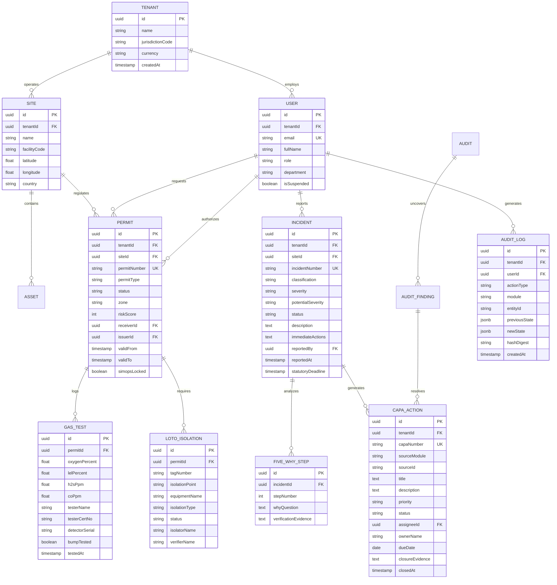

# Database & Persistence Specification — AD6.Ai Smart HSE

**Document Version:** 2.0.0-PROD  
**Database Architecture:** Multi-Tenant Relational Schema with Row-Level Security (RLS)  
**Target Engine:** PostgreSQL 16 (Google Cloud SQL / AWS RDS)  
**ORM / Migration Tooling:** Prisma ORM / Drizzle ORM  

---

## 1. Storage Assessment: Current vs. Target

### 1.1 Current State (Prototype Layer)
The running prototype utilizes a dual-tier client/server persistence mechanism:
- **Primary Client Persistence:** Browser `localStorage` segmented into unified storage keys:
  - Incidents: `ad6_incidents` (canonical) and `ad6_enterprise_incidents` (legacy fallback).
  - Permits to Work: `ad6_permits` and `ad6_enterprise_permits`.
  - CAPA Corrective Actions: `ad6_capas` and `ad6_enterprise_capas`.
  - Inspections & Audits: `ad6_inspections`, `ad6_audits`.
- **Offline Resilient Storage:** IndexedDB managed through `idb` (`v8.0.3`) for offline incident queueing (`services/offlineStorage.ts`, `services/syncEngine.ts`).
- **Server Audit Log:** Append-only in-memory log buffer (`inMemoryAuditTrail`) exposed at `/api/audit/trail` with non-blocking Google Cloud Logging export (`services/audit.js`).

### 1.2 Target Enterprise State (Production Relational Database)
Production requires durable, ACID-compliant relational storage with strict **Row-Level Security (RLS)** isolating tenant data between operating entities (e.g. Petroleum Development Oman vs. ADNOC Onshore vs. Aramco joint ventures).

---

## 2. Entity Relationship Diagram (ERD)



---

## 3. Core Relational Schema Specification

### 3.1 Tenancy & Organization Boundaries
All primary tables maintain a mandatory `tenantId UUID NOT NULL` indexed foreign key. Row-Level Security (RLS) is enabled on all tables:
```sql
ALTER TABLE incidents ENABLE ROW LEVEL SECURITY;
CREATE POLICY tenant_isolation_policy ON incidents
    FOR ALL
    USING (tenant_id = current_setting('app.current_tenant_id')::uuid);
```

### 3.2 Key Entity Definitions

#### Table: `incidents`
| Column | Type | Constraints | Description |
|---|---|---|---|
| `id` | `UUID` | Primary Key, `default gen_random_uuid()` | Internal unique identifier |
| `tenant_id` | `UUID` | FK `tenants(id)`, Index | Tenant organizational boundary |
| `site_id` | `UUID` | FK `sites(id)`, Index | Operational facility location |
| `incident_number` | `VARCHAR(32)` | Unique, Not Null | Formatted statutory ID (e.g., `INC-2026-OMN-0419`) |
| `classification` | `VARCHAR(64)` | Not Null | Near Miss, LTI, MTC, First Aid, PSE |
| `severity` | `VARCHAR(16)` | Not Null | Low, Medium, High, Critical |
| `potential_severity`| `VARCHAR(16)` | Not Null | SIF potential severity rating |
| `status` | `VARCHAR(32)` | Not Null | Reported, Under Investigation, CAPA Pending, Closed |
| `description` | `TEXT` | Not Null | Detailed factual narrative |
| `reported_by` | `UUID` | FK `users(id)` | Author of the incident report |
| `statutory_deadline`| `TIMESTAMPTZ`| Not Null | Deadline for OSHAD Form G / MoL filing |

#### Table: `permits`
| Column | Type | Constraints | Description |
|---|---|---|---|
| `id` | `UUID` | Primary Key | Internal permit ID |
| `permit_number` | `VARCHAR(32)` | Unique, Not Null | E.g., `PTW-2026-8848` |
| `type` | `VARCHAR(32)` | Not Null | Hot Work, Cold Work, Confined Space, Working at Height |
| `status` | `VARCHAR(32)` | Not Null | Requested, Active, Suspended, Closed |
| `receiver_id` | `UUID` | FK `users(id)` | Field lead custody holder |
| `issuer_id` | `UUID` | FK `users(id)` | Area Authority authorizing permit |
| `simops_locked` | `BOOLEAN` | Default `false` | True if blocked by co-located hazard clash |
| `risk_score` | `INT` | Not Null | $1 - 25$ based on $5 \times 5$ Risk Matrix |

---

## 4. Audit Trail & Tamper Resistance Architecture

All state alterations write to `audit_logs` with a cryptographic digest:
$$\text{hashDigest} = \text{SHA256}(\text{previousDigest} + \text{userId} + \text{actionType} + \text{entityId} + \text{timestamp} + \text{newStateJSON})$$

This creates a forward-linked blockchain-like audit trail ensuring regulatory defensibility during statutory inquiries by Abu Dhabi Public Health Centre (ADPHC) or the Oman Ministry of Labour.

---

## 5. Synthetic Seed Data Strategy

All demonstration and test fixtures utilize realistic, fictionalized Gulf industrial assets:
- **Tenant 1 (Oman Concession):** Gulf Energy Maritime & Upstream LLC (`OMN-FHD-01`, Fahud-West Gas Gathering Station, Block 6). Currency: `OMR` (3 decimal precision).
- **Tenant 2 (UAE Asset):** Al-Ruwais Polyolefin Asset LLC (`UAE-RUW-02`, Extrusion & Reactor Train 2). Currency: `AED`.
- **Tenant 3 (KSA Marine):** Ras Al-Khair Heavy Lift Facility (`KSA-RAK-01`). Currency: `SAR`.

Zero actual corporate personal identifiable information (PII) or classified operational telemetry is contained within seed scripts.
