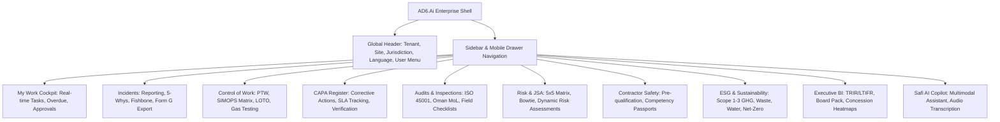

# Design System & UI/UX Specification — AD6.Ai Smart HSE

**Document Version:** 2.0.0-PROD  
**Design Standards:** Enterprise Glassmorphism & High-Legibility Industrial Design  
**Accessibility Target:** WCAG 2.2 Level AA  
**Localization:** English (LTR) & Arabic (RTL)  

---

## 1. UI & UX Architectural Assessment

### 1.1 Aesthetic Philosophy
The AD6.Ai Smart HSE platform combines enterprise industrial authority with modern light-theme glassmorphism and high-density operational telemetry. Rather than the dark, muddy palettes common in legacy industrial tools or over-stylized consumer UIs, AD6.Ai uses:
- High-clarity white/slate surfaces with subtle backdrop blur (`backdrop-blur-md backdrop-saturate-150`).
- Crisp, semantic border definitions (`border-slate-200/70`).
- Clean, typography-driven data hierarchy optimized for control rooms and field tablets under intense Middle Eastern sunlight.

### 1.2 Anti-AI-Slop & Zero-Pill Discipline
The platform avoids generic AI design clichés:
- **No decorative glowing pill badges:** Badges convey concrete status (`Open`, `Under Investigation`, `Active`, `Closed`) with semantic borders and text contrast.
- **No conversational assistant overlays obscuring workflows:** The Safi Copilot is an integrated, drawer-based or modular workspace panel with explicit audit history and human acceptance controls.
- **Decision-First Visual Scaffolding:** Dashboards lead with actionable variances (e.g., `-14% YoY`, `1 Overdue Action`, `1 SIMOPS Clash Detected`) rather than static vanity metrics.

---

## 2. Design Tokens & Visual Hierarchy

### 2.1 Color Palette

```
Primary Brand & Navigation:
├── Navy Slate 950:   #020617 (Deep corporate anchor, sidebar backdrop)
├── Navy Slate 900:   #0f172a (Primary text, headers, active states)
├── Royal Blue 600:   #2563eb (Primary interactive button, link, active tab)
└── Sky Blue 500:     #0ea5e9 (Focus ring, telemetry highlight)

Semantic Risk & Severity Colors:
├── Low / Safe:       #059669 / #10b981 (Emerald Green - LTI Free, Safe gas test)
├── Moderate / Alert: #d97706 / #f59e0b (Amber / Gold - CAPA Due, Advisory warning)
├── High / Danger:    #dc2626 / #ef4444 (Crimson Red - SIF Precursor, SWA Stoppage)
└── Critical:         #7f1d1d / #991b1b (Deep Maroon - SIF Fatal risk, H2S breach)

Backgrounds & Glassmorphism Surfaces:
├── App Canvas:       #f8fafc (Slate 50 canvas)
├── Card Surface:     rgba(255, 255, 255, 0.85) (with border-slate-200/70)
└── Modal Overlay:    rgba(15, 23, 42, 0.50) (with backdrop-blur-sm)
```

### 2.2 Typography Hierarchy

| Level | Size | Weight | Tracking | Primary Usage |
|---|---|---|---|---|
| **Display 1** | 36px / 2.25rem | 900 (Black) | `-0.025em` | Executive KPI Big Numbers, Milestone Man-Hours |
| **Heading 1** | 24px / 1.5rem | 800 (ExtraBold) | `-0.02em` | Page Titles, Major Module Headers |
| **Heading 2** | 18px / 1.125rem | 700 (Bold) | `-0.01em` | Section Titles, Card Headers, Modal Titles |
| **Heading 3** | 14px / 0.875rem | 600 (SemiBold) | `normal` | Table Column Headers, Form Subheadings |
| **Body Primary** | 13px / 0.8125rem | 500 (Medium) | `normal` | Narrative text, Incident descriptions, Field notes |
| **Data Monospace** | 12px / 0.75rem | 600 (SemiBold) | `tight` | Permit Numbers, Coordinates, Hash Digests, Timestamps |

### 2.3 Spacing & Layout Rhythm
- Base spacing unit: 4px (`0.25rem`).
- Container max-width: `max-w-[1720px]` with fluid horizontal margins.
- Card padding: standard `p-5` or `p-6` (`1.25rem`–`1.5rem`).
- Form input height: standard `h-10` (`2.5rem`) or `h-11` (`2.75rem`) for high-touch touchscreens.

---

## 3. Information Architecture & Navigation



---

## 4. Reusable UI Components & Specifications

### 4.1 Card Container (`EnterpriseCard`)
- **Structure:** Clean white rounded rectangle (`rounded-2xl` or `rounded-3xl`), slate border, glassmorphism blur, optional card action header, and segmented footer.
- **Responsiveness:** Auto-stacks on screens $< 1024\text{px}$.

### 4.2 Segregated Action Approval Button (`SoDActionButton`)
- **Behavior:** Dynamically evaluates current user against entity author/assignee.
- **Visual State:** If the user attempts self-authorization (e.g. Permit Receiver signing Issuer block), the button renders in a disabled amber/red warning state with an explanatory tooltip: `"Segregation of Duties Policy Violation: Receiver cannot authorize as Area Authority"`.

### 4.3 AI Governance Indicator (`AITag` & `AIGovernanceCard`)
- **Marker:** Prominently displays the model identifier (e.g., `Gemini 3.8 Flash`), execution timestamp, confidence interval, and human approval status.
- **Interactive Actions:** `Accept Draft`, `Edit Suggestion`, `Reject AI Output`.

---

## 5. Responsive Design & Field PWA Behavior

| Viewport | Device Class | Layout Adaptation |
|---|---|---|
| **$375\text{px} - 640\text{px}$** | Mobile (Field Smartphone) | Single column, sticky bottom navigation bar, large tap targets ($48\text{px}$ minimum), high-contrast daylight mode, audio-first narrative input. |
| **$768\text{px} - 1024\text{px}$** | Tablet (Site Supervisor Toughpad) | Two-column grid, expandable inspection accordions, collapsible sidebar, touch-friendly signature pads. |
| **$1280\text{px} - 1920\text{px}+$** | Desktop / Control Room Screen | Full multi-column dashboard, SIMOPS clash matrix, side-by-side incident investigation and RCA tree builder. |

---

## 6. Accessibility & Localization (WCAG 2.2 AA & RTL)

### 6.1 Contrast & Readability
- All text on background surfaces meets or exceeds a contrast ratio of $4.5:1$ for normal text and $3:1$ for large display numbers.
- Error states do not rely solely on color; they include an explicit warning icon and descriptive inline copy.

### 6.2 Arabic RTL Engine
- Built-in `dir="rtl"` support with dedicated Arabic font stack (`font-arabic`, Tajawal / Cairo).
- Automatic mirror transformation of layout grids, chevron indicators, input alignments, and timeline progressions.
- Dual Calendar component supporting standard Gregorian and Umm al-Qura / Islamic Hijri dates for official GCC government reporting.
