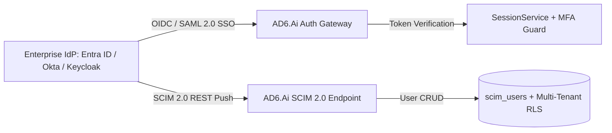

# Identity Provider (IdP) Matrix & SCIM 2.0 Specification
### AD6.Ai Smart HSE Enterprise Platform — Sovereign & Multi-Cloud Identity Integration

---

## 1. Enterprise IdP Architectural Overview

AD6.Ai supports production-ready OpenID Connect (OIDC) and SAML 2.0 integration for enterprise single sign-on (SSO) and automated user lifecycle provisioning via SCIM 2.0 (RFC 7643 / RFC 7644).



---

## 2. Documented Identity Provider Matrix

| IdP Provider | Supported Protocols | Discovery / Metadata Endpoint | Standard Scopes | Key Claim Mappings | SCIM 2.0 Endpoint Base |
|---|---|---|---|---|---|
| **Microsoft Entra ID (Azure AD)** | OIDC / OAuth 2.0, SAML 2.0 | `https://login.microsoftonline.com/{tenantId}/v2.0/.well-known/openid-configuration` | `openid profile email offline_access User.Read` | `oid` $\rightarrow$ `sub`<br>`upn` $\rightarrow$ `email`<br>`roles` $\rightarrow$ Enterprise Role<br>`amr: ["mfa"]` $\rightarrow$ MFA Verified | `https://app.ad6.ai/api/v1/scim/v2/Users` |
| **Okta Enterprise Workforce** | OIDC, SAML 2.0, SCIM 2.0 | `https://{yourOktaDomain}.okta.com/.well-known/openid-configuration` | `openid profile email groups` | `sub` $\rightarrow$ `sub`<br>`email` $\rightarrow$ `email`<br>`groups` $\rightarrow$ Enterprise Role<br>`amr: ["mfa"]` $\rightarrow$ MFA Verified | `https://app.ad6.ai/api/v1/scim/v2/Users` |
| **Keycloak IAM (GCC Sovereign Cloud)** | OIDC, SAML 2.0 | `https://auth.concession.om/realms/{realm}/.well-known/openid-configuration` | `openid profile email roles` | `sub` $\rightarrow$ `sub`<br>`email` $\rightarrow$ `email`<br>`realm_access.roles` $\rightarrow$ Enterprise Role<br>`acr: "mfa"` $\rightarrow$ MFA Verified | `https://app.ad6.ai/api/v1/scim/v2/Users` |

---

## 3. RBAC & Claim Mapping Rules

External groups and roles map deterministically into AD6.Ai Enterprise Roles:

```typescript
if (group.includes('admin')) -> EnterpriseRole.TENANT_ADMIN
if (group.includes('director')) -> EnterpriseRole.GROUP_HSE_DIRECTOR
if (group.includes('site_manager')) -> EnterpriseRole.SITE_MANAGER
if (group.includes('officer')) -> EnterpriseRole.HSE_OFFICER
if (group.includes('supervisor')) -> EnterpriseRole.SUPERVISOR
if (group.includes('auditor')) -> EnterpriseRole.AUDITOR_READONLY
if (group.includes('contractor_admin')) -> EnterpriseRole.CONTRACTOR_ADMIN
default -> EnterpriseRole.FIELD_WORKER
```

---

## 4. SCIM 2.0 Endpoint Operations

| Method | Path | Action | Payload / Schema |
|---|---|---|---|
| `GET` | `/api/v1/scim/v2/Users` | List users with pagination | `urn:ietf:params:scim:api:messages:2.0:ListResponse` |
| `GET` | `/api/v1/scim/v2/Users/:id` | Get user by ID | `urn:ietf:params:scim:schemas:core:2.0:User` |
| `POST` | `/api/v1/scim/v2/Users` | Provision new user | User JSON with `userName`, `emails`, `roles`, `active` |
| `PUT` | `/api/v1/scim/v2/Users/:id` | Replace user resource | Complete User JSON |
| `PATCH` | `/api/v1/scim/v2/Users/:id` | Update attributes (e.g. deactivate) | SCIM Patch Operation (`replace active: false`) |
| `DELETE` | `/api/v1/scim/v2/Users/:id` | Soft-deactivate user | Sets `active = false` |

---

## 5. Security Invariants & Fail-Closed Behavior
- **Segregation of Duties (SoD):** Roles assigned via SCIM cannot bypass safety-critical invariants (e.g. Permit Receiver cannot be assigned Area Authority on the same shift).
- **MFA Enforcement:** Users assigned high-privilege roles (`TENANT_ADMIN`, `GROUP_HSE_DIRECTOR`, `SITE_MANAGER`) require verified MFA claims (`amr: ["mfa"]`). If absent, session is restricted to Read-Only until step-up authentication is fulfilled.
- **Tenant Isolation:** All SCIM operations are bound to the caller's verified `tenant_id` via Row-Level Security.
