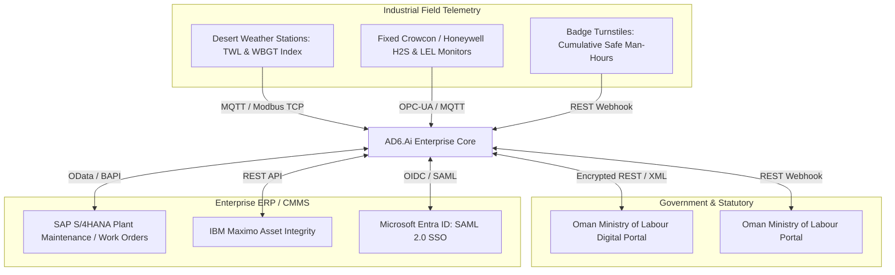

# Integration Catalogue & External Interface Guide — AD6.Ai Smart HSE

**Document Version:** 2.0.0-PROD  
**Integration Lead:** Senior Full-Stack & Cloud Integration Engineer  
**Security Standard:** Zero-Trust Ingress / Egress Control  

---

## 1. Verified Implemented Integrations

### 1.1 Google Gemini AI Platform (`@google/genai v1.42.0`)
- **Status:** **Implemented & Verified**
- **Purpose:** Multimodal incident classification, 5-Why root cause tree formulation, Safi conversational advice, and field audio transcription.
- **Architectural Boundary:** Invoked exclusively from backend `routes/geminiRouter.ts` via server environment variable `GEMINI_API_KEY`.
- **Primary Models Used:**
  - `gemini-3.8-flash`: Primary high-speed reasoning model for structured incident analysis and JSA generation.
  - `gemini-3.1-flash-lite`: Low-latency fallback model when primary encounters rate limits.
  - `gemini-3.5-transcribe`: High-fidelity audio speech-to-text for field observations.
- **Resilience:** Automatic 3-tier retry with exponential backoff and a 30-second abort controller.

### 1.2 Real-Time WebSocket Hub (`Socket.IO v4.8.3`)
- **Status:** **Implemented & Verified**
- **Purpose:** Low-latency bi-directional event broadcast for real-time Control Room incident alerts and SIMOPS clashes.
- **Implementation:** Integrated into `server.ts` listening for `'newIncident'`, broadcasting `'incidentUpdate'` to all active supervisory clients.

### 1.3 Interactive Geospatial GIS (`Leaflet v1.9.4` & `Leaflet.heat`)
- **Status:** **Implemented & Verified**
- **Purpose:** Concession risk heatmap rendering, asset GPS coordinate visualization, and SIMOPS spatial exclusion zones.
- **Components:** `components/GISMapModule.tsx`, `components/LocationSelector.tsx`.

### 1.4 Client-Side Evidence Generation (`jsPDF 2.5.1` & `XLSX 0.18.5`)
- **Status:** **Implemented & Verified**
- **Purpose:** Instant client-side compilation of Oman MoL 24-Hour Notice Form (MD 286/2008 Annex 1) statutory reporting packets, Oman MoL notices, and Excel CAPA registers.

---

## 2. Proposed Enterprise Integrations (Target State)



---

## 3. Integration Specifications

### 3.1 Desert Thermal Stress Weather Station Ingestion (IoT)
- **Protocol:** MQTT over TLS 1.3
- **Ingestion Frequency:** Every 10 minutes
- **Payload Schema:**
```json
{
  "stationId": "WX-FHD-06",
  "facilityCode": "OMN-FHD-01",
  "ambientTempC": 44.2,
  "relativeHumidity": 38.5,
  "windSpeedMps": 3.2,
  "twlWattsPerSqM": 108.4,
  "wbgtIndexC": 33.1,
  "timestamp": "2026-10-23T10:30:00Z"
}
```
- **Automated Rule:** If `twlWattsPerSqM < 115.0` or `wbgtIndexC >= 32.2`, trigger immediate broadcast stand-down notification to all active field work permits in that sector.

### 3.2 Enterprise CMMS Integration (SAP / IBM Maximo)
- **Direction:** Bi-directional synchronization.
- **Workflow:** When an incident RCA identifies an equipment failure (e.g., failed pump mechanical seal), the resulting CAPA creates a high-priority Maintenance Work Order (Order Type `PM01`) in SAP. Upon work order completion in SAP, the CAPA status in AD6.Ai transitions to `Pending Verification`.

---

## 4. Failure Modes, Dead-Letter Queues & Runbooks

| Integration Point | Failure Scenario | Automated Recovery Behavior | Manual Runbook Action |
|---|---|---|---|
| **Gemini AI API** | Quota exhausted / HTTP 429 | Failover to `gemini-3.1-flash-lite`. If both fail, return structured fallback template. | Verify billing credit in Google Cloud Console; increase quota limits. |
| **IoT Weather Stream** | Loss of station connectivity $> 30\text{m}$ | Default to conservative summer midday work stoppage policy (12:30–15:30 ban). | Site safety officer takes manual psychrometric / sling hygrometer reading. |
| **Statutory Portal** | Government endpoint offline | Queue statutory notice in `outbound_dead_letter_queue` with exponential retry. | Download generated Form G PDF and submit via government manual email protocol. |
