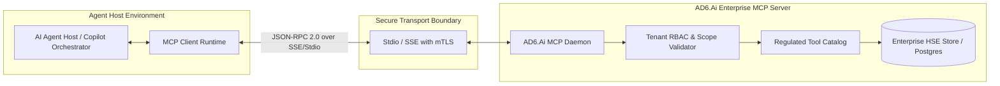

# Model Context Protocol (MCP) Integration Specification — AD6.Ai Smart HSE

**Document Version:** 2.0.0-PROD  
**Integration Standard:** Model Context Protocol (MCP) Specification 2024-11-05  
**Architect:** Principal AI Systems & Agentic Workflow Specialist  

---

## 1. Executive Overview & Current Status

### 1.1 Implementation Assessment
- **Current Status:** **Proposed Architecture** (Pre-implementation blueprint documented in `enterprise-architecture/`).
- The current prototype executes AI queries via direct server-side calls in `routes/geminiRouter.ts` using `@google/genai`.
- **Target Goal:** Expose AD6.Ai operational data, hazard registers, and SIMOPS matrices as an official **MCP Server**, allowing external agentic tools (such as Claude Desktop, Cursor, or internal enterprise orchestration agents) to securely interact with HSE data without exposing raw database credentials.

---

## 2. MCP Architecture & Security Boundaries



---

## 3. Tool Catalog & Schemas

### Tool 1: `query_concession_incidents`
- **Purpose:** Search historical incidents across Oman and GCC concessions with severity and date range filters.
- **Access Level:** Read-Only (`SCOPE_READ_INCIDENTS`).
- **Input Schema:**
```json
{
  "$schema": "http://json-schema.org/draft-07/schema#",
  "type": "object",
  "properties": {
    "jurisdiction": {
      "type": "string",
      "enum": ["Oman", "GCC", "KSA", "All"]
    },
    "severity": {
      "type": "string",
      "enum": ["Low", "Medium", "High", "Critical"]
    },
    "classification": {
      "type": "string",
      "description": "e.g. Near Miss, Lost Time Injury, Equipment Failure"
    },
    "limit": {
      "type": "integer",
      "default": 10,
      "maximum": 50
    }
  },
  "required": ["jurisdiction"]
}
```

### Tool 2: `check_simops_clash`
- **Purpose:** Verify whether a proposed permit zone clashes with existing active hot work or heavy lifting activities.
- **Access Level:** Read-Only (`SCOPE_READ_PERMITS`).
- **Input Schema:**
```json
{
  "type": "object",
  "properties": {
    "siteCode": { "type": "string", "example": "OMN-FHD-01" },
    "zone": { "type": "string", "example": "Zone 1 - Main Flare Stack" },
    "workType": { "type": "string", "enum": ["Hot Work", "Confined Space", "Heavy Lifting"] },
    "proposedStart": { "type": "string", "format": "date-time" },
    "proposedEnd": { "type": "string", "format": "date-time" }
  },
  "required": ["siteCode", "zone", "workType", "proposedStart", "proposedEnd"]
}
```

### Tool 3: `propose_corrective_action`
- **Purpose:** Stage a draft CAPA originating from an automated RCA investigation.
- **Access Level:** Gated Write (`SCOPE_WRITE_CAPA`).
- **Human In The Loop Requirement:** Staged actions are saved with `status: 'StagedDraft'`. They **cannot** be marked `Active` or `Closed` without explicit site supervisor approval in the UI.

---

## 4. MCP Server Implementation Example (TypeScript)

```typescript
import { Server } from "@modelcontextprotocol/sdk/server/index.js";
import { StdioServerTransport } from "@modelcontextprotocol/sdk/server/stdio.js";
import { CallToolRequestSchema, ListToolsRequestSchema } from "@modelcontextprotocol/sdk/types.js";
import { EnterpriseDataStore } from "../services/enterpriseDataStore.js";

const server = new Server(
  {
    name: "ad6-smart-hse-mcp",
    version: "2.0.0",
  },
  {
    capabilities: {
      tools: {},
    },
  }
);

// Register Available Tools
server.setRequestHandler(ListToolsRequestSchema, async () => {
  return {
    tools: [
      {
        name: "query_concession_incidents",
        description: "Retrieve historical industrial incidents from verified GCC concessions",
        inputSchema: {
          type: "object",
          properties: {
            jurisdiction: { type: "string", enum: ["Oman", "GCC", "KSA", "All"] },
            severity: { type: "string", enum: ["Low", "Medium", "High", "Critical"] },
          },
          required: ["jurisdiction"],
        },
      },
    ],
  };
});

// Tool Invocation Handler
server.setRequestHandler(CallToolRequestSchema, async (request) => {
  if (request.params.name === "query_concession_incidents") {
    const { jurisdiction, severity } = request.params.arguments as any;
    const allIncidents = EnterpriseDataStore.getIncidents();
    
    let filtered = allIncidents;
    if (jurisdiction !== "All") {
      filtered = filtered.filter(i => (i.location && i.location.includes(jurisdiction)) || i.jurisdiction === jurisdiction);
    }
    if (severity) {
      filtered = filtered.filter(i => i.severity === severity);
    }

    return {
      content: [
        {
          type: "text",
          text: JSON.stringify(filtered.slice(0, 10), null, 2),
        },
      ],
    };
  }

  throw new Error(`Tool not found: ${request.params.name}`);
});

// Start Stdio Transport
const transport = new StdioServerTransport();
await server.connect(transport);
console.error("AD6.Ai HSE MCP Server running on stdio");
```

---

## 5. Security & Isolation Controls

1. **Least Privilege:** Tools are granularly scoped. No MCP tool is permitted to drop records, truncate tables, or bypass SoD constraints.
2. **Read-Only by Default:** All diagnostic, statistical, and hazard lookup tools operate in read-only mode.
3. **Draft Gating:** Any agent action proposing an incident report or permit creation creates an unapproved draft requiring physical human confirmation.
