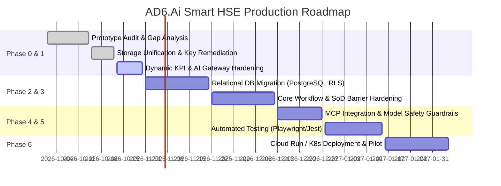

# Project Implementation Blueprint & Roadmap — AD6.Ai Smart HSE

**Document Version:** 2.0.0-PROD  
**Program Lead:** Principal Solutions Architect & Technical Project Director  
**Methodology:** Iterative Risk-Driven Agile / Regulated Systems Quality Assurance  
**Target Completion:** 14-Week Production Readiness Plan  

---

## 1. Executive Implementation Strategy

The transition of the AD6.Ai Smart HSE platform from an advanced prototype to a production-grade, enterprise-hardened software solution follows a structured 7-phase implementation blueprint. Each phase establishes measurable quality gates, verified against **ISO/IEC 25010** software product quality standards and **OWASP ASVS 4.0** verification controls.

---

## 2. Work Breakdown Structure (WBS)

### Phase 0: Discovery & Prototype Audit (Completed)
- **WP-0.1:** Comprehensive 10-point audit across Requirements, Architecture, Code Quality, Functional Correctness, Security, AI Quality, Testing, UX, Documentation, and Operations.
- **WP-0.2:** Delivery of 100-point enterprise readiness scorecard and remediated issue log.

### Phase 1: Architecture Foundation & Storage Unification (In Progress)
- **WP-1.1 (DATA-01):** Unify fragmented `localStorage` keys across `DemoDataLoader` and `EnterpriseDataStore`. Completed dual-key write sync with `ad6-incidents-updated` events.
- **WP-1.2 (CALC-01):** Ground executive KPIs in live data. Replaced hardcoded LTIFR (`0.12`) and TRIR (`0.24`) in `ExecutiveDashboard.tsx` with dynamic calculations.
- **WP-1.3 (AI-01):** Extend `/api/gemini/generate` proxy timeout from 7s to 30s to eliminate false timeouts on complex multi-prompt RCA requests.
- **WP-1.4 (SEC-02):** Implement client and server-side Segregation of Duties (SoD) enforcement on PTW authorizations and CAPA closures.

### Phase 2: Enterprise Persistence & Authentication (Weeks 5–7)
- **WP-2.1 (Database Provisioning):** Provision managed PostgreSQL 16 on Google Cloud SQL with automated failover and daily point-in-time recovery (PITR).
- **WP-2.2 (Schema Migration):** Implement Prisma ORM models defined in `docs/DATABASE.md` with tenant Row-Level Security (RLS).
- **WP-2.3 (SSO Integration):** Implement SAML 2.0 / OIDC provider hooks for corporate Microsoft Entra ID (Azure AD) and Okta.

### Phase 3: Core Workflow Hardening (Weeks 8–10)
- **WP-3.1 (SIMOPS Engine):** Enhance geometric spatial collision detection for co-located permits within 50-meter zones.
- **WP-3.2 (Offline PWA Sync):** Full bi-directional conflict resolution in `services/syncEngine.ts` for offline mobile inspections.
- **WP-3.3 (Statutory PDF Generator):** Production rendering of Oman MoL 24-Hour Notice Form (MD 286/2008 Annex 1) and Oman MoL statutory notification packages using server-side Puppeteer / jsPDF.

### Phase 4: AI Governance & MCP Connectivity (Weeks 11–12)
- **WP-4.1 (MCP Server):** Build and deploy a secure Node.js MCP server exposing read-only hazard lookups and schema-validated incident query tools.
- **WP-4.2 (Prompt-Injection Hardening):** Deploy input sanitation filters stripping prompt-injection heuristics before model ingestion.
- **WP-4.3 (Human-In-The-Loop Validation):** Ensure all AI suggestions require explicit user checkbox acceptance before persisting to records.

### Phase 5: Automated Testing & Security Assurance (Weeks 13–14)
- **WP-5.1 (Unit & Component Test Suite):** 85%+ code coverage on business calculations (TRIR, LTIFR, TWL heat index, SoD checks) using Vitest.
- **WP-5.2 (E2E Automated Testing):** 25 automated Playwright end-to-end scenarios covering critical user journeys.
- **WP-5.3 (Independent Pen-Test & ASVS Audit):** Third-party penetration test verifying zero privilege escalation or API key leakage.

### Phase 6: Production Release & Operations (Weeks 15+)
- **WP-6.1 (Containerized CI/CD):** GitHub Actions pipeline building multi-architecture Docker images with Trivy vulnerability scanning.
- **WP-6.2 (Cloud Run Blue/Green Deployment):** Automated zero-downtime canary rollout with Cloud Monitoring alerts.

---

## 3. Risk Management Matrix

| Risk ID | Description | Severity | Probability | Mitigation Strategy | Owner |
|---|---|---|---|---|---|
| **RSK-01** | Field worker connectivity loss during critical permit sign-off | High | High | Offline-first IndexedDB queue with background sync worker and local digital signatures. | Mobile Lead |
| **RSK-02** | Gemini API quota throttling during plant turnaround surge | High | Medium | Dual-model fallback (`gemini-3.8-flash` ➔ `gemini-3.1-flash-lite`) and intelligent response caching. | AI Architect |
| **RSK-03** | Segregation of Duties bypass via manipulated client state | Critical | Low | Dual-layer verification: client UI disablement + mandatory server `/api/auth/verify-access` rejection. | Security Lead |
| **RSK-04** | Discrepancy in statutory heat ban enforcement across borders | High | Low | Isolated regional compliance engine with hardcoded MD 286/2008 and Oman MoL MD 286/2008 clock rules. | Compliance Lead |
